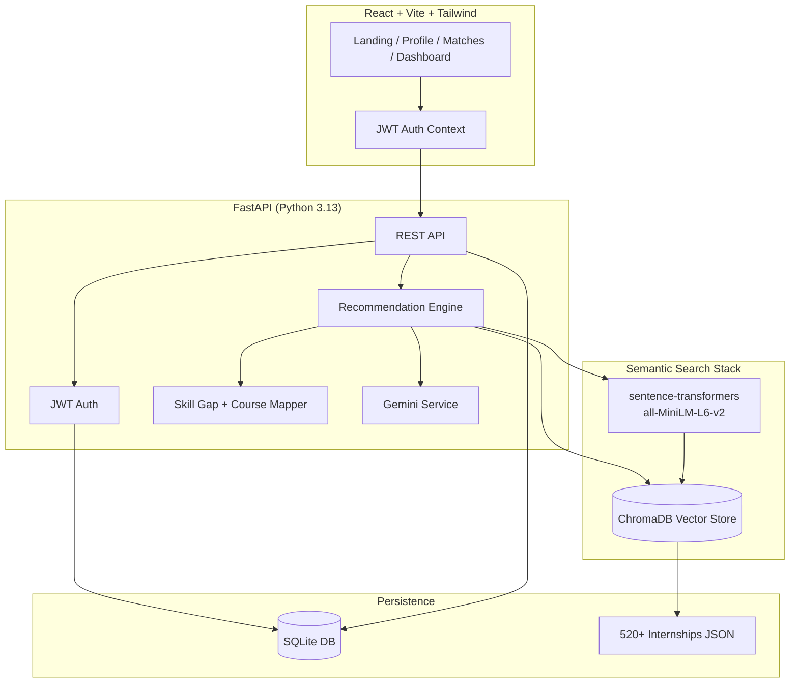

# InternPath — AI Internship Recommendation System

InternPath is a full-stack internship recommendation platform that uses **semantic search** (sentence-transformers + ChromaDB), **Gemini AI** explanations, **JWT authentication**, and a student **dashboard** with application tracking.

Built for SIH (Smart India Hackathon) and designed to be resume-worthy for top tech companies.

## Screenshots

| Landing | Recommendations | Dashboard |
|---------|-----------------|-----------|
|  |  |  |

> Placeholder paths — add screenshots to `docs/screenshots/` after running locally.

## Architecture



### How recommendations work

1. Student completes profile (skills, interests, domains, location).
2. Profile is encoded into a semantic query document.
3. **sentence-transformers** (`all-MiniLM-L6-v2`) embeds the query.
4. **ChromaDB** performs cosine similarity search over 520+ internship embeddings.
5. Skill overlap is computed against required job skills.
6. **Gemini** generates plain-English match explanations and a personalized roadmap (with template fallback if no API key).
7. Missing skills map to curated **NPTEL / Coursera / YouTube** courses.

## Tech Stack

| Layer | Technology |
|-------|------------|
| Frontend | React 18, Vite, Tailwind CSS, React Router |
| Backend | FastAPI, SQLAlchemy, Pydantic v2 |
| Auth | JWT (python-jose), bcrypt password hashing |
| Database | SQLite |
| Vector DB | ChromaDB |
| Embeddings | sentence-transformers (`all-MiniLM-L6-v2`) |
| LLM | Google Gemini API (free tier) |
| Python | 3.13 compatible dependencies |

## Project Structure

```
sih/
├── backend/
│   ├── app/
│   │   ├── main.py              # FastAPI entry point
│   │   ├── auth/                # JWT + password hashing
│   │   ├── routers/             # auth, profile, recommendations, dashboard
│   │   └── services/            # chroma, embeddings, gemini, skill gap
│   ├── data/internships.json    # 520 generated listings
│   ├── scripts/generate_dataset.py
│   └── requirements.txt
├── src/                         # React frontend
├── .env.example
└── README.md
```

## Setup

### Prerequisites

- Python 3.11+ (tested with **3.13**)
- Node.js 18+
- Gemini API key (optional — fallback templates work without it)

### 1. Clone and configure environment

```bash
git clone https://github.com/ilakiya-tech/sih.git
cd sih
cp .env.example .env
```

Edit `.env`:

```env
GEMINI_API_KEY=your_gemini_api_key_here
JWT_SECRET_KEY=replace_with_a_long_random_secret
```

Get a free Gemini key: https://aistudio.google.com/apikey

### 2. Backend setup

```bash
cd backend
python -m venv .venv

# Windows
.venv\Scripts\activate

# macOS/Linux
source .venv/bin/activate

pip install -r requirements.txt
python scripts/generate_dataset.py   # regenerates 520 internships if needed
uvicorn app.main:app --reload --port 8000
```

On first startup, the API seeds **ChromaDB** with internship embeddings (may take a few minutes while the model downloads).

Health check: http://127.0.0.1:8000/api/health

### 3. Frontend setup

```bash
cd ..
npm install
npm run dev
```

Open http://localhost:5173

The Vite dev server proxies `/api` to the FastAPI backend.

## API Endpoints

| Method | Endpoint | Description |
|--------|----------|-------------|
| POST | `/api/auth/register` | Create account |
| POST | `/api/auth/login` | Get JWT token |
| GET | `/api/auth/me` | Current user |
| GET/PUT | `/api/profile` | User profile |
| POST | `/api/recommendations` | Semantic recommendations + skill gap |
| GET | `/api/dashboard` | Saved internships, applications, stats |
| POST | `/api/dashboard/saved` | Save internship |
| POST | `/api/dashboard/applications` | Track application |

## Features

- **Semantic search** — Replaces TF-IDF with `all-MiniLM-L6-v2` embeddings
- **ChromaDB** — Persistent vector store for internship similarity search
- **Gemini AI** — Match explanations + personalized skill roadmaps
- **JWT auth** — Register/login with SQLite-backed user profiles
- **520+ internships** — SWE, Data Science, ML, Web Dev, DevOps, Cybersecurity, and more
- **Skill gap analysis** — Precise skill comparison with NPTEL/Coursera/YouTube courses
- **Dashboard** — Application tracker, saved roles, profile completion score

## Environment Variables

See `.env.example` for all options:

| Variable | Description |
|----------|-------------|
| `GEMINI_API_KEY` | Google Gemini API key |
| `JWT_SECRET_KEY` | Secret for signing JWT tokens |
| `DATABASE_URL` | SQLite connection string |
| `CHROMA_PERSIST_DIR` | ChromaDB storage path |
| `EMBEDDING_MODEL` | HuggingFace model name (default: `all-MiniLM-L6-v2`) |
| `CORS_ORIGINS` | Allowed frontend origins |

## License

MIT — built for educational and hackathon use.
