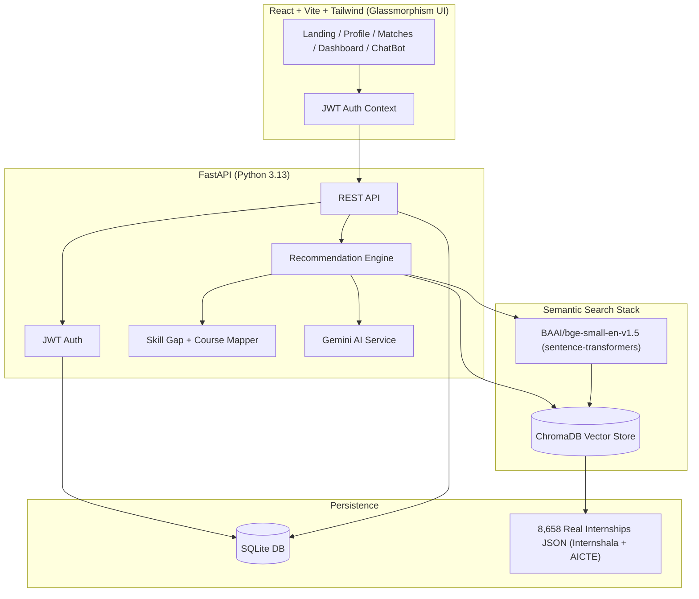

# InternPath — AI Internship Recommendation System

InternPath is a full-stack internship recommendation platform that uses **semantic search** (BAAI/bge-small-en-v1.5 + ChromaDB), **Gemini AI** explanations, **JWT authentication**, and a student **dashboard** with application tracking.

Built for SIH (Smart India Hackathon) using **8,658 real internship listings** scraped from Internshala and the AICTE portal.

## Screenshots

| Landing | Recommendations | Dashboard |
|---------|-----------------|-----------|
|  |  |  |

> Add screenshots to `docs/screenshots/` after running locally.

## Architecture



### How recommendations work

1. Student completes profile (skills, interests, domains, location).
2. Profile is encoded into a semantic query document.
3. **BAAI/bge-small-en-v1.5** embeds the query into a 384-dimensional vector.
4. **ChromaDB** performs cosine similarity search over **8,658 real internship embeddings**.
5. Hard domain metadata filters (`$in`) narrow results to the student's preferred domains.
6. Skill overlap is computed against required job skills (matched vs. missing).
7. **Gemini** generates plain-English match explanations and a personalized roadmap.
8. Missing skills map to curated **NPTEL / Coursera / YouTube** courses.

## Tech Stack

| Layer | Technology |
|-------|------------|
| Frontend | React 18, Vite, Tailwind CSS (Glassmorphism), React Router |
| Backend | FastAPI, SQLAlchemy, Pydantic v2 |
| Auth | JWT (python-jose), bcrypt password hashing |
| Database | SQLite |
| Vector DB | ChromaDB (persistent, cosine similarity) |
| Embeddings | `BAAI/bge-small-en-v1.5` via sentence-transformers |
| LLM | Google Gemini API (free tier) |
| Data Sources | Internshala + AICTE Portal (8,658 real listings) |
| Python | 3.11+ (tested with 3.13) |

## Real Dataset

The recommendation engine runs on **8,658 real internship listings** from two sources:

| Source | Count | ID Prefix | Description |
|--------|-------|-----------|-------------|
| **Internshala** | ~6,400 | `real-is-` | Real student internships across India |
| **AICTE Portal** | ~2,200 | `real-ac-` | Government-recognized internship programs |

The ETL pipeline (`etl_pipeline.py`) processes raw CSVs from these sources, normalizes skills, domains, stipends, and work modes, and outputs the final `backend/data/internships.json`.

## Project Structure

```
sih/
├── backend/
│   ├── app/
│   │   ├── main.py              # FastAPI entry point
│   │   ├── auth/                # JWT + password hashing
│   │   ├── routers/             # auth, profile, recommendations, dashboard
│   │   └── services/            # chroma, embeddings, gemini, skill gap
│   ├── data/
│   │   └── internships.json     # 8,658 real internship listings
│   ├── chroma_data/             # Persistent ChromaDB vector store
│   └── requirements.txt
├── data_processing/             # Raw CSVs from Internshala + AICTE
├── etl_pipeline.py              # ETL: raw CSV → internships.json
├── re_ingest.py                 # Re-seed ChromaDB after data changes
├── evaluate_recs.py             # Evaluate recommendation quality
├── validate_chromadb.py         # Verify vector store integrity
├── validate_dataset.py          # Check dataset quality
├── src/                         # React frontend
│   ├── components/
│   │   ├── InternshipCard.jsx   # Animated internship cards
│   │   ├── SkeletonCard.jsx     # Skeleton loading state
│   │   ├── ChatBot.jsx          # AI chatbot assistant
│   │   ├── BottomNav.jsx        # Glassmorphism nav
│   │   └── ...
│   └── pages/
│       ├── Dashboard.jsx
│       ├── Recommendations.jsx
│       ├── Profile.jsx
│       └── ...
├── tailwind.config.js           # Slate/Indigo palette + Inter font
├── .env.example
└── README.md
```

## Setup

### Prerequisites

- Python 3.11+ (tested with **3.13**)
- Node.js 18+
- Gemini API key (optional — fallback templates work without it)

### 1. Clone and configure environment

```bash
git clone https://github.com/ilakiya-tech/sih.git
cd sih
cp .env.example .env
```

Edit `.env`:

```env
GEMINI_API_KEY=your_gemini_api_key_here
JWT_SECRET_KEY=replace_with_a_long_random_secret
```

Get a free Gemini key: https://aistudio.google.com/apikey

### 2. Backend setup

```bash
cd backend
python -m venv .venv

# Windows
.venv\Scripts\activate

# macOS/Linux
source .venv/bin/activate

pip install -r requirements.txt
uvicorn app.main:app --reload --port 8000
```

On first startup, the API automatically seeds **ChromaDB** with embeddings for all 8,658 internships using `BAAI/bge-small-en-v1.5` (downloads ~130MB on first run).

Health check: http://127.0.0.1:8000/api/health

### 3. Frontend setup

```bash
cd ..
npm install
npm run dev
```

Open http://localhost:5173

The Vite dev server proxies `/api` to the FastAPI backend.

### 4. Re-ingesting data (optional)

If you update `backend/data/internships.json` and need to re-seed ChromaDB:

```bash
python re_ingest.py
```

## API Endpoints

| Method | Endpoint | Description |
|--------|----------|-------------|
| POST | `/api/auth/register` | Create account |
| POST | `/api/auth/login` | Get JWT token |
| GET | `/api/auth/me` | Current user |
| GET/PUT | `/api/profile` | User profile |
| POST | `/api/profile/upload-resume` | AI resume parsing (Gemini) |
| POST | `/api/recommendations` | Semantic recommendations + skill gap |
| GET | `/api/dashboard` | Saved internships, applications, stats |
| POST | `/api/dashboard/saved` | Save internship |
| DELETE | `/api/dashboard/saved/{id}` | Unsave internship |
| POST | `/api/dashboard/applications` | Track application |

## Features

- **Real data** — 8,658 actual internship listings from Internshala & AICTE (not synthetic)
- **Semantic search** — `BAAI/bge-small-en-v1.5` embeddings (top MTEB benchmark performer)
- **ChromaDB** — Persistent vector store with cosine similarity + metadata domain filters
- **Gemini AI** — Match explanations + personalized skill roadmaps
- **JWT auth** — Register/login with SQLite-backed user profiles
- **AI Resume Parsing** — Upload a PDF; Gemini extracts skills and education automatically
- **Skill gap analysis** — Precise matched/missing skill breakdown with NPTEL/Coursera/YouTube courses
- **Dashboard** — Application tracker, saved roles, profile completion score
- **Glassmorphism UI** — Inter font, backdrop-blur, Slate/Indigo color palette, skeleton loaders
- **Chatbot assistant** — Context-aware help guiding users through the platform

## Environment Variables

See `.env.example` for all options:

| Variable | Description |
|----------|-------------|
| `GEMINI_API_KEY` | Google Gemini API key |
| `JWT_SECRET_KEY` | Secret for signing JWT tokens |
| `DATABASE_URL` | SQLite connection string |
| `CHROMA_PERSIST_DIR` | ChromaDB storage path |
| `EMBEDDING_MODEL` | HuggingFace model name (default: `BAAI/bge-small-en-v1.5`) |
| `CORS_ORIGINS` | Allowed frontend origins |

## License

MIT — built for educational and hackathon use.
